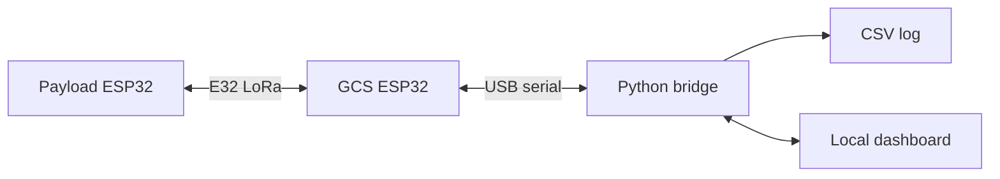

# GMAT 2026 Rocket Payload - Group 1

ESP32 rocket payload and ground station for the GMAT 2026 final project. Reads MPU6050 acceleration/gyro and BMP280 pressure/temperature at 5 Hz, with CSV logging and a local dashboard.

## Architecture



## Project Layout

| Path | Purpose |
|---|---|
| [firmware/payload](firmware/payload/README.md) | Sensors, payload states and E32 UART transport. |
| [firmware/gcs](firmware/gcs/README.md) | Radio-to-USB bridge. |
| [ground/bridge](ground/bridge/README.md) | Serial telemetry logger. |
| [ground/dashboard](ground/dashboard/README.md) | Plots, reported payload state, barometer values and raw terminal. |
| [flowchart/system_explanation.pdf](flowchart/system_explanation.pdf) | Payload schematic. |

## Run

Requires Python 3.9+ and PlatformIO Core.

```sh
python -m pip install -r ground/bridge/requirements.txt
pio run -d firmware/payload -e esp32dev
pio run -d firmware/gcs -e esp32dev
python ground/dashboard/dashboard.py --port COM5 --log telemetry.csv
```

## Telemetry

GCS USB uses 115200 baud. Python drops the raw flags column, maps the state to
`IDLE` or `FIRE_ACCEPTED`, and adds UTC `rx_time`:

```text
seq,t_ms,ax,ay,az,gx,gy,gz,state,pressure_pa,temperature_centi_c,rx_time
```

Acceleration is mg, gyro is 0.1 degrees/s, pressure is Pa and temperature is
0.01 degrees C. The USB serial interface carries telemetry and diagnostics. Radio packets
use CRC-protected framing but have no authentication or delivery acknowledgment.
Update both firmwares and Python together; old telemetry formats are rejected.
See [packet definitions](firmware/payload/include/packet.h) and
[radio framing](firmware/payload/README.md#e32-uart-radio).