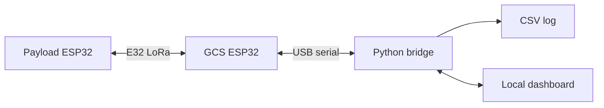

# GMAT 2026 Rocket Payload - Group 1

ESP32 rocket payload and ground station for the GMAT 2026 final project.
Reads MPU6050 acceleration/gyro and BMP280 pressure/temperature at 5 Hz,
with CSV logging and a local dashboard.

**WIP: bench simulation only.** ARM/FIRE simulate flight states; GPIO25 stays
LOW. Keep ejection hardware disconnected. Radio is disabled until wiring,
power and E32 settings are confirmed.

## Architecture



## Project Layout

| Path | Purpose |
|---|---|
| [firmware/payload](firmware/payload/README.md) | Sensors, bench states and E32 UART transport. |
| [firmware/gcs](firmware/gcs/README.md) | Radio-to-USB bridge. |
| [ground/bridge](ground/bridge/README.md) | Serial logger and CLI commands. |
| [ground/dashboard](ground/dashboard/README.md) | Plots, flight state, barometer values, raw terminal and bench controls. |
| [schematic/skematik.pdf](schematic/skematik.pdf) | Payload schematic. |

## Run

Requires Python 3.9+ and PlatformIO Core. Firmware targets classic ESP32.

```sh
python -m pip install -r ground/bridge/requirements.txt
pio run -d firmware/payload -e esp32dev
pio run -d firmware/gcs -e esp32dev
python ground/dashboard/dashboard.py --port COM5 --log bench.csv
```

Use the actual GCS port and a new log filename. Open http://127.0.0.1:8000.
Run either the dashboard or CLI bridge against the port, not both. See component
READMEs for wiring, upload instructions and tests. With radio disabled, GCS
receives no payload telemetry.

## Telemetry

USB uses 115200 baud. Python logs these fields, adding UTC `rx_time`:

```text
seq,t_ms,ax,ay,az,gx,gy,gz,state,flags,pressure_pa,temperature_centi_c,rx_time
```

Acceleration is mg, gyro is 0.1 degrees/s, pressure is Pa and temperature is
0.01 degrees C. Commands are `ARM`, `DISARM` and `FIRE` lines. Radio packets
use CRC-protected framing but have no authentication or delivery acknowledgment.
Update both firmwares and Python together; old telemetry formats are rejected.
See [packet definitions](firmware/payload/include/packet.h) and
[radio framing](firmware/payload/README.md#e32-uart-radio-disabled-by-default).

## Remaining Work

- Confirm GCS wiring, radio settings and power capacity; validate on hardware.
- Implement SD logging and calibrated battery monitoring.
- Define and validate altitude, flight detection and deployment behavior.

Host tests and JavaScript syntax checks passed. ESP32 builds remain unverified
because the platform download was blocked. Browser layout, sensor accuracy,
electrical behavior and RF operation are unverified. Not flight-ready.
